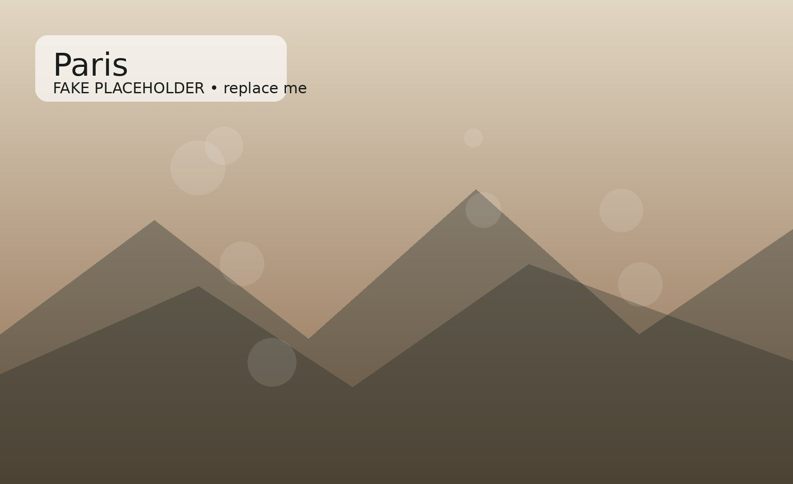
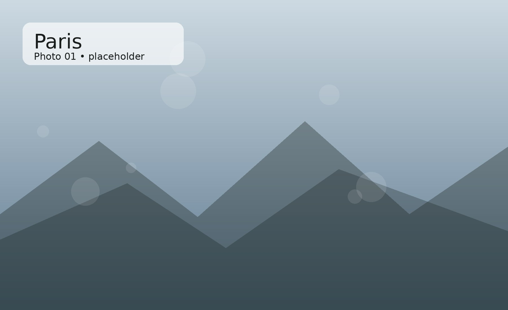
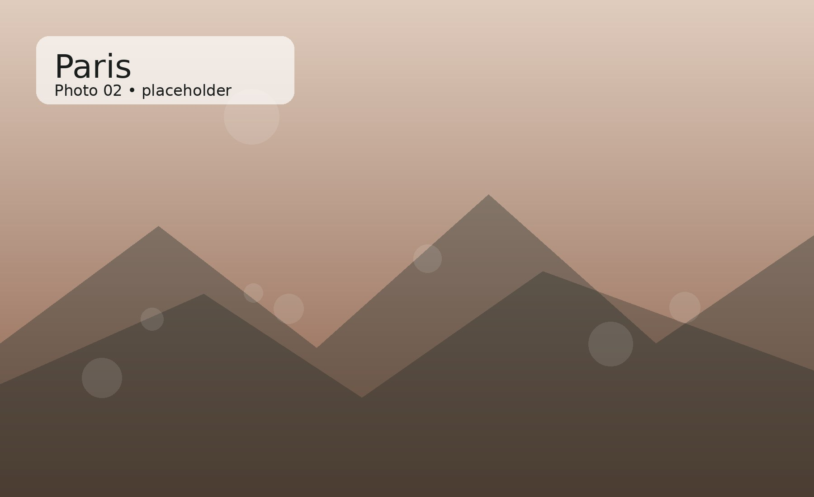
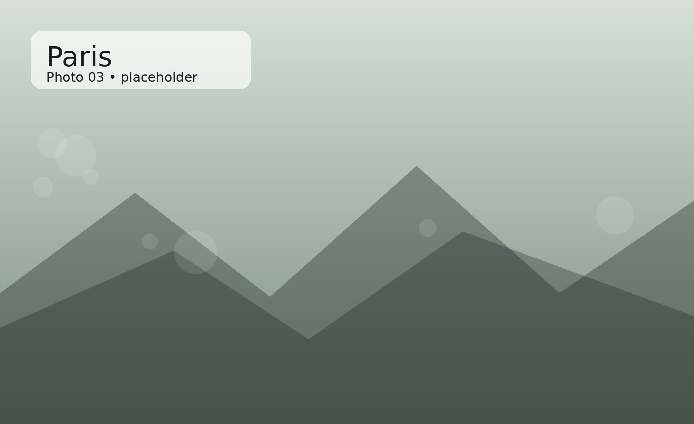

# Paris

A sample editorial story for Personal Atlas. These images are **fake placeholders** so you can see how the finished layout works. Replace them with your own photos using the same filenames.

*Cover image caption. This is where a short, human description can go.*

## The story

This is an example of a longer story section. You can mix normal text, large photographs, and smaller moments without needing to create a separate HTML page for every story.

:::fullwidth

*Full-width photo caption. A wider image can break up the text and create a more magazine-like rhythm.*
:::

Here is another paragraph between images. The goal is to make each place or project feel like a chapter rather than a list of resume bullets.

## A few moments

:::gallery

*First moment. A short caption describing what is happening.*

*Second moment. Captions can add context without interrupting the story.*

*Third moment. Keep these short and personal.*
:::

## Looking back

One final paragraph can close the story and link it back to the larger Personal Atlas.
